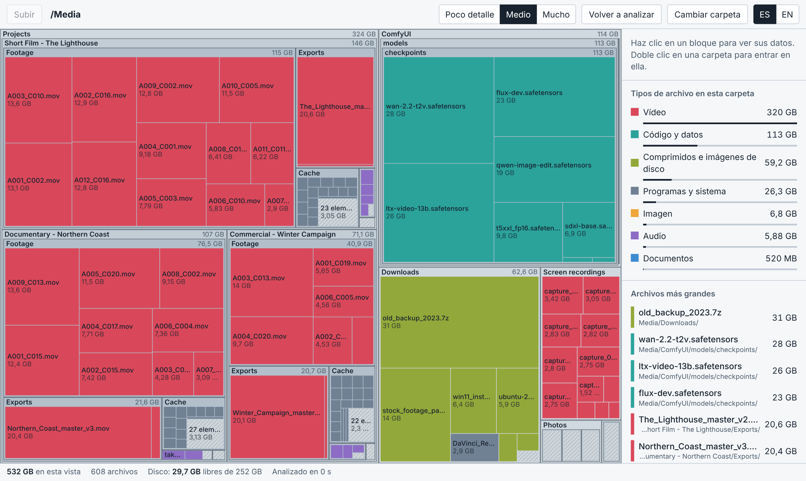
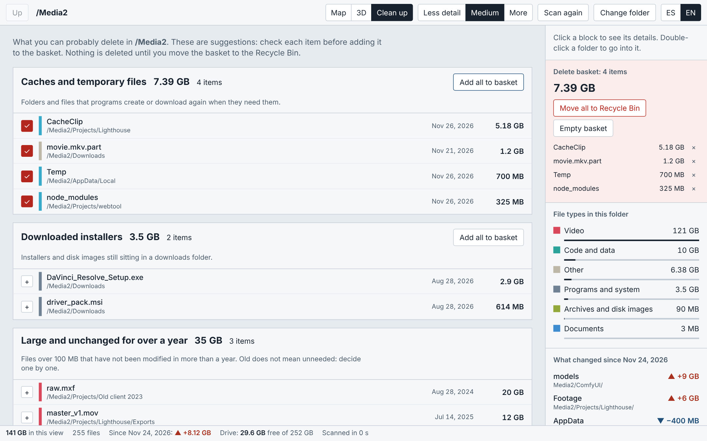
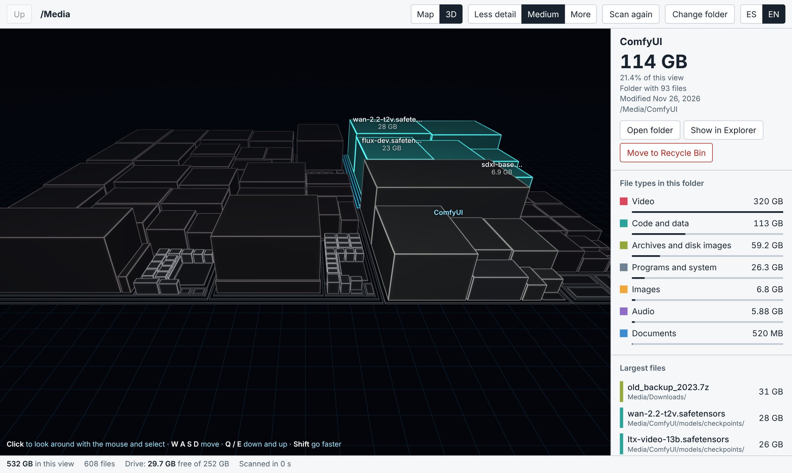

# Mapa de Disco

**Mira qué se está comiendo tu disco.** Mapa de Disco analiza un disco o una carpeta y lo dibuja como un mapa: cada archivo es un bloque, cuanto más grande el bloque más espacio ocupa, y el color indica qué tipo de archivo es.

Funciona en Windows como un único `.exe` o como script de Python. Sin instalador, sin cuenta, y nada sale de tu ordenador.

*[Read in English](README.md)*



## Cómo ejecutarlo

Hay dos formas. Las dos dan exactamente la misma interfaz.

### Opción A: el .exe (el análisis más rápido)

1. Entra en **[Releases](../../releases/latest)** y descarga `MapaDeDisco.exe`.
2. Haz doble clic. Se abre una ventana negra pequeña (déjala abierta) y la interfaz aparece en tu navegador.
3. Elige un disco o una carpeta.

El programa no está firmado digitalmente, porque un certificado cuesta dinero cada año y esta herramienta es gratuita. Eso tiene dos consecuencias en Windows:

- **SmartScreen** puede mostrar un aviso la primera vez. Pulsa **Más información** y luego **Ejecutar de todas formas**.
- El **Control inteligente de aplicaciones**, en los equipos con Windows 11 que lo tienen activado, bloquea los programas sin firma y no ofrece "Ejecutar de todas formas". Si te pasa, usa la opción B.

### Opción B: Python (funciona donde el .exe está bloqueado)

1. Instala [Python](https://www.python.org/downloads/) 3.8 o superior (también está en la Microsoft Store). No hacen falta paquetes adicionales.
2. En esta página pulsa **Code → Download ZIP** y descomprímelo.
3. Abre una terminal en esa carpeta y ejecuta:

```
python mapadisco.py
```

La edición en Python analiza varias veces más despacio y usa más memoria en discos muy grandes. Todo lo demás es idéntico.

Para ver las carpetas que Windows protege, ejecuta cualquiera de las dos opciones como administrador.

## Qué puedes hacer

- **Leer el mapa.** Las carpetas son marcos anidados con su nombre y tamaño total; los archivos son bloques de color. Pasa el ratón por cualquier bloque para ver nombre, tamaño y fecha.
- **Entrar en una carpeta.** Doble clic. Vuelve atrás con **Subir**, la tecla Retroceso o la ruta de arriba.
- **Filtrar por tipo.** Pulsa "Vídeo" (o cualquier otro tipo) en el panel lateral: el mapa atenúa todo lo demás y la lista muestra los archivos más grandes de ese tipo.
- **Encontrar los archivos más grandes.** El panel lateral lista siempre los 100 archivos más grandes de la carpeta que estás viendo.
- **Actuar sobre lo que encuentras.** Selecciona un bloque y pulsa **Abrir ubicación** o **Enviar a la papelera** (siempre pregunta antes y todo se puede recuperar).
- **Elegir el nivel de detalle.** Los archivos pequeños se agrupan en un bloque rayado para que el mapa se lea bien; sube el detalle para ver más.
- **Cambiar de idioma.** Español e inglés, desde el selector de la interfaz.
- **Ver qué puedes borrar probablemente.** La vista **Limpiar** lista cachés y temporales, instaladores que siguen en carpetas de descargas, archivos grandes sin tocar desde hace más de un año y duplicados.
- **Borrar de una vez.** Añade elementos a la **cesta de borrado** desde cualquier vista (con el botón o la tecla B), mira cómo suma el total y envíalo todo a la papelera con una sola confirmación.
- **Ver qué ha crecido.** Cada análisis se compara con uno anterior de la misma carpeta: las carpetas que han crecido llevan la marca ▲ con cuánto, y el panel lateral lista lo que ha cambiado.
- **Ver también el espacio libre.** El botón **Espacio libre** añade un bloque verde con el espacio libre del disco, para compararlo con todo lo demás. En 3D es una losa verde baja. Solo aparece cuando analizas un disco entero y estás en su nivel superior; desaparece en cuanto entras en una carpeta.
- **Recorrerlo en 3D.** Cambia a la vista **3D** y la carpeta se convierte en una ciudad de neón: cada archivo es una torre, más alta cuanto más ocupa.

### La vista Limpiar



| Apartado | Qué señala |
| --- | --- |
| Cachés y temporales | Carpetas como `node_modules`, `__pycache__`, `.cache`, `Cache`, `CacheClip`, `Media Cache Files`, `Temp`, y archivos terminados en `.tmp`, `.dmp`, `.part` o `.crdownload` |
| Instaladores descargados | Archivos `.exe`, `.msi`, `.iso` y similares dentro de una carpeta de descargas |
| Grandes y sin cambios en más de un año | Archivos de más de 100 MB que no se modifican desde hace más de 365 días |
| Duplicados | Archivos de más de 10 MB con el mismo contenido en más de un sitio (se buscan cuando lo pides) |

Son sugerencias, no veredictos. Nunca se sugiere nada de dentro de `Windows`, `Program Files` o `ProgramData`, y nada se borra hasta que envías la cesta a la papelera.

### La vista 3D



| Control | Qué hace |
| --- | --- |
| Clic en la escena | Mirar con el ratón y seleccionar lo que hay bajo la cruz |
| W A S D | Moverse |
| Q / E | Bajar / subir |
| Mayús | Ir más rápido |
| Clic en una carpeta | Se ilumina y todo lo demás pierde el color |
| Intro o doble clic | Entrar en la carpeta seleccionada |
| Retroceso | Subir un nivel |
| Clic en un archivo | Muestra **Abrir ubicación** y **Enviar a la papelera** (teclas: F y Supr) |
| Esc | Soltar el ratón |

La vista 3D necesita un navegador con WebGL 2 (Chrome, Edge o Firefox actuales).

### Colores

| Color | Tipo | Ejemplos |
| --- | --- | --- |
| Rojo | Vídeo | mp4, mov, mkv, mxf, braw |
| Ámbar | Imagen | jpg, png, raw, psd, exr |
| Violeta | Audio | wav, mp3, flac |
| Azul | Documentos | pdf, docx, xlsx |
| Verde | Comprimidos e imágenes de disco | zip, 7z, iso |
| Turquesa | Código y datos | py, json, safetensors, gguf |
| Gris azulado | Programas y sistema | exe, dll, tmp |
| Arena | Otros | todo lo demás |

## Conviene saber

- **Enviar algo a la papelera no libera espacio** hasta que la vacías. La barra inferior lleva la cuenta de lo que has enviado.
- **Los archivos de OneDrive que están solo en la nube no se cuentan ni se muestran**, porque no ocupan espacio en tu disco. La barra inferior indica cuánto se ha dejado fuera.
- **Los duplicados se comparan por contenido, con un atajo.** Los archivos de hasta 64 MB se comparan enteros. Los más grandes, por tamaño y por 18 muestras repartidas a lo largo del archivo, que es rápido y muy fiable con vídeo e imagen, pero no es una comprobación byte a byte. En cada grupo se marca la copia más antigua como la que se conserva.
- **"Qué ha cambiado" necesita dos análisis.** El primer análisis de una carpeta no tiene con qué compararse. La comparación usa el análisis anterior más reciente que tenga al menos 12 horas.
- Los tamaños son los del archivo, no el "tamaño en disco" exacto. Con archivos comprimidos, dispersos o enlaces duros la cifra real puede variar un poco.
- Los enlaces de carpeta (uniones y enlaces simbólicos) se omiten para no contar nada dos veces.
- El árbol de archivos completo se guarda en memoria. Un disco de sistema con un par de millones de archivos puede usar unos cientos de MB de RAM mientras el programa está abierto.

## Privacidad y seguridad

- El programa solo escucha en `127.0.0.1` (tu propio ordenador). No hace conexiones de red ni recoge datos.
- Cada petición necesita un código aleatorio creado al arrancar, así que otras páginas abiertas en tu navegador no pueden hablar con él.
- Para comparar análisis, guarda un resumen pequeño de cada uno (nombres y tamaños de carpetas, nunca nombres de archivos) en `%APPDATA%\MapaDeDisco\history`, en tu propio disco. Borra esa carpeta cuando quieras olvidarlos.
- Nunca borra nada de forma definitiva. La única acción sobre tus archivos es **Enviar a la papelera**, limitada a lo que hay dentro de la carpeta analizada y solo después de confirmar. Si algo no cabe en la papelera, Windows muestra su propio aviso antes de hacer nada.

## Compílalo tú

Necesitas [Go](https://go.dev/dl/) 1.24 o superior. No hay más dependencias.

```
git clone https://github.com/TU-USUARIO/mapa-de-disco.git
cd mapa-de-disco
go build -trimpath -ldflags "-s -w" -o MapaDeDisco.exe .
```

En Windows también puedes hacer doble clic en `build.bat`.

El código compila también en Linux y macOS, lo que viene bien para desarrollar, pero no son el objetivo: la lista de discos, "Abrir ubicación" y la papelera solo están completas en Windows.

## Cómo funciona

```
main.go          escáner, árbol en memoria y API HTTP local
features.go      sugerencias de limpieza, búsqueda de duplicados y comparación con análisis anteriores
mapadisco.py     el mismo programa en Python (solo biblioteca estándar), para cuando el .exe no puede ejecutarse
sys_windows.go   lo específico de Windows: discos, papelera, Explorador, detección de OneDrive
sys_other.go     equivalentes mínimos para otros sistemas
web/index.html   toda la interfaz (HTML, CSS y JavaScript en un archivo, incrustado en el .exe)
docs/            capturas
```

- **El análisis** recorre el árbol de carpetas en paralelo y guarda nombre, tamaño, fecha y tipo de cada archivo.
- **El mapa** es un treemap "squarified" dibujado en un canvas. El navegador nunca recibe el árbol entero: para cada vista el servidor envía solo los bloques que se van a ver y agrupa el resto.
- **La interfaz** es un único HTML estático, sin frameworks ni recursos externos, así que funciona sin conexión.

## Licencia

[MIT](LICENSE). Úsalo, cámbialo, compártelo.

Hecho por Luis Ángel Mendaña, cineasta. Construido conversando con Claude.
