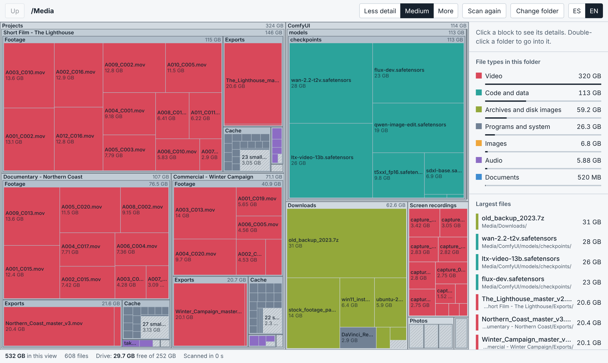
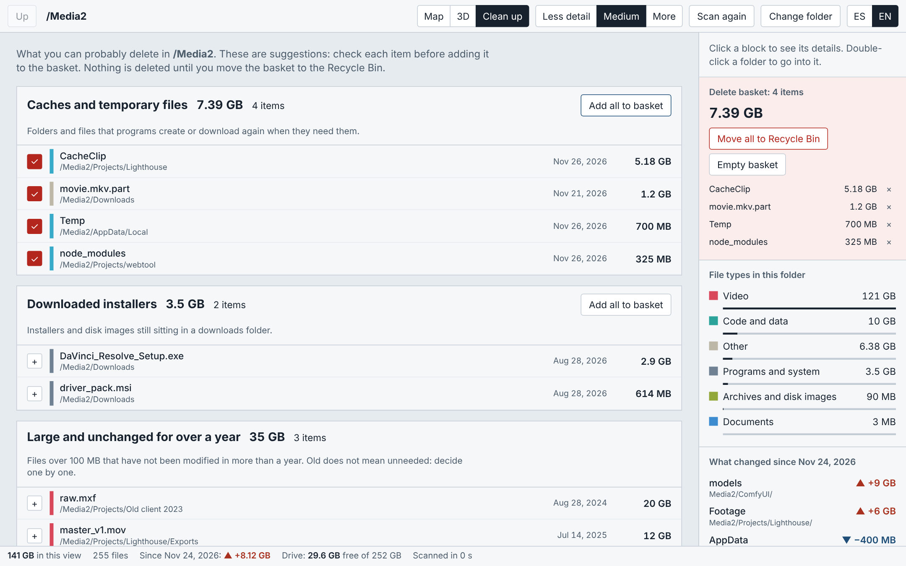
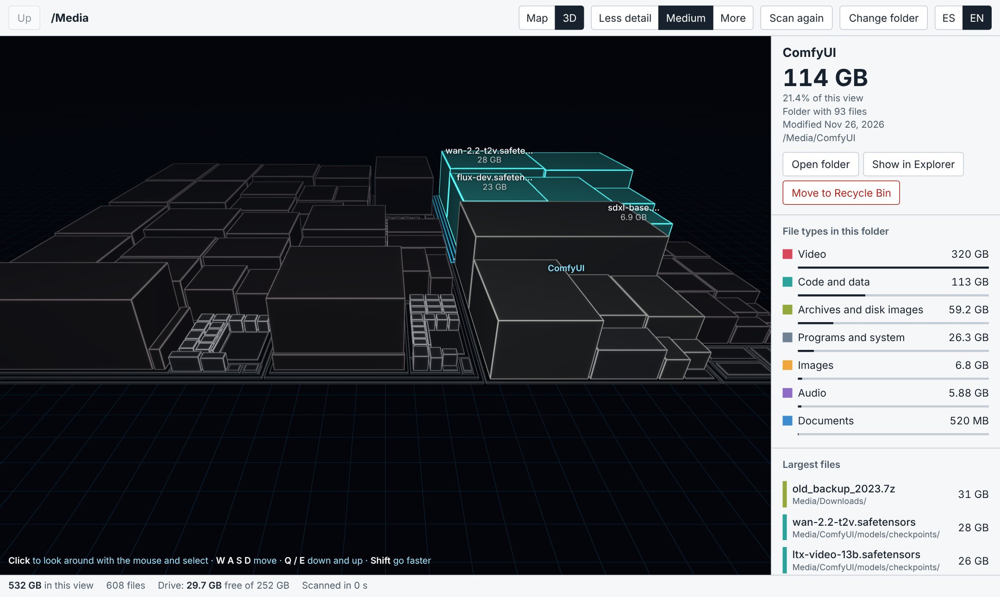
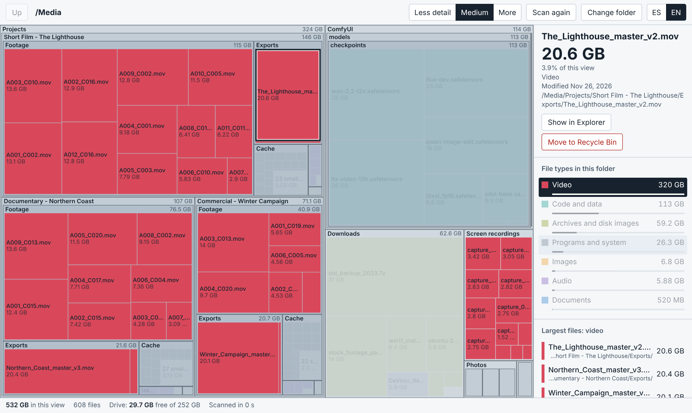

# Mapa de Disco

**See what is eating your disk.** Mapa de Disco scans a drive or a folder and draws it as a map: every file is a block, the bigger the block the more space it takes, and the color tells you what kind of file it is.

It runs on Windows as a single `.exe` or as a Python script. No installer, no account, nothing leaves your computer.

*[Leer en español](README.es.md)*



## Run it

There are two ways. Both give you exactly the same interface.

### Option A: the .exe (fastest scanning)

1. Go to **[Releases](../../releases/latest)** and download `MapaDeDisco.exe`.
2. Double-click it. A small black window opens (keep it open) and the interface appears in your browser.
3. Pick a drive or a folder.

The program is not code-signed, because a certificate costs money every year and this is a free tool. That has two consequences on Windows:

- **SmartScreen** may show a warning the first time. Click **More info**, then **Run anyway**.
- **Smart App Control**, on the Windows 11 computers where it is turned on, blocks unsigned programs with no "Run anyway" option. If that happens to you, use Option B.

### Option B: Python (works where the .exe is blocked)

1. Install [Python](https://www.python.org/downloads/) 3.8 or newer (it is also in the Microsoft Store). No extra packages are needed.
2. On this page click **Code → Download ZIP** and unzip it.
3. Open a terminal in that folder and run:

```
python mapadisco.py
```

The Python edition scans a few times slower and uses more memory on very large drives. Everything else is identical.

To see folders that Windows protects, run either option as administrator.

## What you can do

- **Read the map.** Folders are nested frames with their name and total size; files are colored blocks. Hover any block for its name, size and date.
- **Go into a folder.** Double-click it. Go back with **Up**, the Backspace key, or the path at the top.
- **Filter by type.** Click "Video" (or any other type) in the side panel: the map dims everything else and the list shows the largest files of that type.
- **Find the biggest files.** The side panel always lists the 100 largest files inside the folder you are looking at.
- **Act on what you find.** Select a block, then **Show in Explorer** or **Move to Recycle Bin** (it always asks first, and everything stays recoverable).
- **Choose the detail level.** Small files are grouped into a hatched block so the map stays readable; raise the detail to see more of them.
- **Switch language.** English and Spanish, from the selector in the interface.
- **See what you can probably delete.** The **Clean up** view lists caches and temporary files, installers left in downloads folders, large files untouched for over a year, and duplicates.
- **Delete in one go.** Add items to the **delete basket** from any view (button or the B key), watch the total add up, and move everything to the Recycle Bin with a single confirmation.
- **See what has grown.** Each scan is compared with an earlier one of the same folder: folders that grew are marked ▲ with how much, and the side panel lists what changed.
- **See the free space too.** The **Free space** button adds a green block for the free space on the drive, so you can compare it with everything else. In 3D it is a low green slab. It appears only when you scan a whole drive and are looking at its top level; it disappears as soon as you go into a folder.
- **Fly through it in 3D.** Switch to the **3D** view and the folder becomes a neon city: every file is a tower, taller the more space it takes.

### The Clean up view



| Section | What it flags |
| --- | --- |
| Caches and temporary files | Folders such as `node_modules`, `__pycache__`, `.cache`, `Cache`, `CacheClip`, `Media Cache Files`, `Temp`, and files ending in `.tmp`, `.dmp`, `.part` or `.crdownload` |
| Downloaded installers | `.exe`, `.msi`, `.iso` and similar files inside a Downloads folder |
| Large and unchanged for over a year | Files over 100 MB not modified in more than 365 days |
| Duplicates | Files over 10 MB with the same content in more than one place (searched when you ask for it) |

These are suggestions, not verdicts. Nothing inside `Windows`, `Program Files` or `ProgramData` is ever suggested, and nothing is deleted until you move the basket to the Recycle Bin.

### The 3D view



| Control | What it does |
| --- | --- |
| Click the scene | Look around with the mouse, and select what is under the crosshair |
| W A S D | Move |
| Q / E | Down / up |
| Shift | Go faster |
| Click a folder | It glows and everything else loses its color |
| Enter or double-click | Go into the selected folder |
| Backspace | Up one level |
| Click a file | Shows **Show in Explorer** and **Move to Recycle Bin** (keys: F and Delete) |
| Esc | Release the mouse |

The 3D view needs a browser with WebGL 2 (current Chrome, Edge or Firefox).



### Colors

| Color | Type | Examples |
| --- | --- | --- |
| Red | Video | mp4, mov, mkv, mxf, braw |
| Amber | Images | jpg, png, raw, psd, exr |
| Violet | Audio | wav, mp3, flac |
| Blue | Documents | pdf, docx, xlsx |
| Green | Archives and disk images | zip, 7z, iso |
| Teal | Code and data | py, json, safetensors, gguf |
| Slate | Programs and system | exe, dll, tmp |
| Sand | Other | everything else |

## Good to know

- **Moving something to the Recycle Bin does not free space** until you empty the bin. The status bar keeps a running total of what you have sent there.
- **OneDrive files that live only in the cloud are not counted or shown**, because they take no space on your disk. The status bar tells you how much was left out.
- **Duplicates are compared by content, with one shortcut.** Files up to 64 MB are compared in full. Larger ones are compared by size plus 18 samples spread across the file, which is fast and very reliable for media but is not a byte-by-byte check. In each group the oldest copy is marked as the one to keep.
- **"What changed" needs two scans.** The first scan of a folder has nothing to compare with. Comparisons use the most recent earlier scan that is at least 12 hours old.
- Sizes are file sizes, not exact "size on disk". Compressed files, sparse files and hard links can make the real figure a little different.
- Folder links (junctions and symbolic links) are skipped, so nothing is counted twice.
- The whole file tree is kept in memory. A full system drive with a couple of million files can use a few hundred MB of RAM while the program is open.

## Privacy and safety

- The program only listens on `127.0.0.1` (your own computer). It makes no network connections and collects nothing.
- Every request needs a random token created at startup, so other web pages open in your browser cannot talk to it.
- To compare scans, it saves a small summary of each one (folder names and sizes, never file names) in `%APPDATA%\MapaDeDisco\history` on your own disk. Delete that folder whenever you want to forget them.
- It never deletes anything permanently. The only action on your files is **Move to Recycle Bin**, limited to items inside the folder you scanned, and only after you confirm. If an item is too large for the bin, Windows shows its own warning before doing anything.

## Build it yourself

You need [Go](https://go.dev/dl/) 1.24 or newer. There are no other dependencies.

```
git clone https://github.com/EnlacesCurados/mapa-de-disco.git
cd mapa-de-disco
go build -trimpath -ldflags "-s -w" -o MapaDeDisco.exe .
```

On Windows you can also double-click `build.bat`.

The code builds on Linux and macOS too, which is handy for development, but those builds are not the target: drive listing, "Show in Explorer" and the Recycle Bin are only fully implemented for Windows.

## How it works

```
main.go          scanner, in-memory tree, local HTTP API
features.go      clean-up suggestions, duplicate search, comparison with earlier scans
mapadisco.py     the same program in Python (standard library only), for when the .exe cannot run
sys_windows.go   Windows specifics: drives, Recycle Bin, Explorer, OneDrive detection
sys_other.go     minimal equivalents for other systems
web/index.html   the whole interface (HTML, CSS and JavaScript in one file, embedded in the .exe)
docs/            screenshots
```

- **Scanning** walks the folder tree in parallel and keeps name, size, date and type for every file.
- **The map** is a squarified treemap drawn on a canvas. The browser never receives the full tree: for each view the server sends only the blocks large enough to be visible, and groups the rest.
- **The interface** is one static HTML file with no frameworks and no external resources, so it works offline.

## License

[MIT](LICENSE). Use it, change it, share it.

Made by Luis Ángel Mendaña, filmmaker. Built in conversation with Claude.
